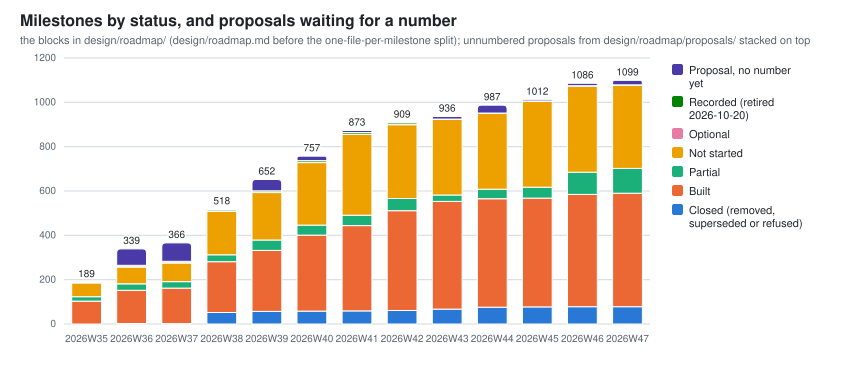

# nife

[](https://github.com/nifeos/nife/actions/workflows/ci.yml?query=branch%3Amain)
[](https://github.com/nifeos/nife#security-and-license)

A capability microkernel in Rust, built from the first instruction. Every driver and server is an
ordinary process, and the kernel allocates no memory of its own. It boots on aarch64, riscv64 and
x86_64, under emulation and on real silicon, and it runs unmodified `ripgrep`
from crates.io ([notes/ripgrep-on-nife.md](https://github.com/nifeos/record/blob/main/notes/ripgrep-on-nife.md)).

It is a demonstrator, per §14 (the project's direction): built to stand next to Linux, macOS and
seL4 on the primitives that define an operating system. The security-critical logic carries
machine-checked proofs. Many agents build it in parallel lanes and the architects
([ARCHITECTS.md](ARCHITECTS.md)) review the outcomes;
[notes/how-this-is-built.md](https://github.com/nifeos/record/blob/main/notes/how-this-is-built.md) has the numbers and their caveats.

*The name is lowercase everywhere and is said like* knife: *Ni + Fe, the Earth's nickel-iron core
([design/naming.md](https://github.com/nifeos/record/blob/main/design/naming.md)).*


*Cobble, guardian of the machinery, designed by calef's kid ([notes/mascot.md](https://github.com/nifeos/record/blob/main/notes/mascot.md)).*

The CI badge under the title is green only when every check `script/ci-build --list` names passes on `main`;
[notes/check-inventory.md](https://github.com/nifeos/record/blob/main/notes/check-inventory.md) says what each one proves.

## Try it

```
git clone https://github.com/nifeos/nife && cd nife
script/setup               # install the pinned toolchain, build the pinned QEMU, then build
script/console             # boot to an interactive shell (add --hvf on Apple Silicon)
script/test                # host tests, then the kernel under QEMU on all three ISAs
script/catch-up            # what changed since you last looked
```

At the `$` prompt try `help`, `echo hello` or `least_authority_demo 7`. Quit with Ctrl-C, or run
`pkill qemu-system-aarch64` from another terminal.

The QEMU comes from `script/ci-qemu`, which `script/setup` runs after the toolchain. When the QEMU on
your PATH is not exactly the version `.qemu-version` pins, it builds that version from source, once,
and says so before it starts. Run `script/ci-qemu` again whenever you want to check.

Every other command, including `script/verify` (the Kani proofs) and `script/bench`, is in
[notes/scripts.md](notes/scripts.md).

## Start here

The design record, which holds the roadmap, the decisions and most of the notes, is its own
repository, [nifeos/record](https://github.com/nifeos/record). This one holds the code, the notes
that document one crate alone, and the tools that check both.

Read in this order, and stop when you have what you came for.

1. [CONTRIBUTING.md](CONTRIBUTING.md): what the project wants from a change, and what to ask about instead of building.
2. [AGENTS.md](AGENTS.md): the rules, for whoever does the work, human or agent. `CLAUDE.md` is a symlink to it.
3. [notes/capabilities.md](notes/capabilities.md): the one idea every design choice here follows from.
4. [design/roadmap/](https://github.com/nifeos/record/blob/main/design/roadmap/README.md): the only status, kept in nifeos/record. Its roadmap script, run with `--ready`, lists what can start.
5. [design/decisions/](https://github.com/nifeos/record/blob/main/design/decisions/README.md): each choice and its argument, refusals included. Cited as `§N`.
6. [notes/adding-a-program.md](https://github.com/nifeos/record/blob/main/notes/adding-a-program.md): the first thing to do with your hands.

Where code lives is in AGENTS.md's [codebase rules](AGENTS.md#the-rules-that-hold-the-codebase-together).
To find anything else, run `script/apropos <word>` before you grep. It searches every note, decision,
roadmap block and module header.

## What it does

This is what the system is, not its status. Each claim points at the artifact that keeps it true.

- Security-critical logic carries Kani proofs, run by `script/verify` and gated in CI. Which
  properties, and their bounds, are in [notes/verification.md](https://github.com/nifeos/record/blob/main/notes/verification.md).
- The kernel does not allocate. Page tables, threads, endpoints and address spaces are retyped out
  of untyped memory that userspace owns.
- Processes come and go. A userspace progenitor builds the system through capability verbs, and
  object revocation tears a process down and reclaims its memory.
- It runs real workloads: a CoreMark-derived program against the native ABI
  ([notes/abi.md](https://github.com/nifeos/record/blob/main/notes/abi.md)), and ordinary Rust `std` programs.
- Three ISAs at parity. Architecture-specific code lives under `kernel/src/arch/`, and parity is a
  gate, per §19 (architectural parity is a tenet).
- SMP on four cores, with per-CPU run queues and no shared run-queue lock.
- Every driver and server runs at EL0, confined by the MMU and, for DMA, by a validator and an
  IOMMU. A driver that misbehaves faults without taking the kernel down.
- It is benchmarked against Linux and macOS on the same core. Every number and caveat is in
  [notes/benchmarks.md](https://github.com/nifeos/record/blob/main/notes/benchmarks.md).

When something faults, you get this instead of a silent death:

```
[EXCEPTION]  Current EL, SP_ELx, Synchronous
             Data abort from the same EL (EC 0x25)

  ESR_EL1   0x0000000096000050   what happened
  FAR_EL1   0x00000000dead0000   the address that faulted
  ELR_EL1   0x0000000040081a40   the instruction that did it
  SPSR_EL1  0x00000000400003c5   the state it was in
```

## The numbers, weekly

[](notes/project-metrics.md)

[notes/project-metrics.md](https://github.com/nifeos/record/blob/main/notes/project-metrics.md) has one row per ISO week, regenerated from git
history by `script/metrics`. Read its first section before you quote a bar: every row applies
today's definitions to old commits.

## Directory

### Use it

- [notes/scripts.md](notes/scripts.md): every `script/` command, and the `cargo xtask` subcommands behind them.
- [notes/shell.md](https://github.com/nifeos/record/blob/main/notes/shell.md): the interactive shell.
- [notes/benchmarks.md](https://github.com/nifeos/record/blob/main/notes/benchmarks.md): measurements against Linux and macOS, with caveats.

### Understand it

- [notes/README.md](https://github.com/nifeos/record/blob/main/notes/README.md): every note, indexed by the question it answers.
- [notes/reading-assembly.md](https://github.com/nifeos/record/blob/main/notes/reading-assembly.md) and [notes/registers.md](https://github.com/nifeos/record/blob/main/notes/registers.md): start here if the code looks like noise.
- [design/fatal-risks/README.md](https://github.com/nifeos/record/blob/main/design/fatal-risks/README.md): the claims that, if false, mean the project should stop.
- [design/journeys/](https://github.com/nifeos/record/tree/main/design/journeys): end-to-end user stories and the milestones they need.

### Contribute

- [CONTRIBUTING.md](CONTRIBUTING.md): how a change is proposed, gated and merged.
- [design/naming.md](https://github.com/nifeos/record/blob/main/design/naming.md): who names things, and how.
- [CODE_OF_CONDUCT.md](CODE_OF_CONDUCT.md): Contributor Covenant 2.1, with its one change explained.

### Project records

- [design/roadmap/](https://github.com/nifeos/record/blob/main/design/roadmap/README.md) and [notes/roadmap.md](https://github.com/nifeos/record/blob/main/notes/roadmap.md): milestones and their status vocabulary.
- [design/decisions/](https://github.com/nifeos/record/blob/main/design/decisions/README.md): what was chosen and refused, and why.
- [design/audit-reports/](https://github.com/nifeos/record/blob/main/design/audit-reports/README.md): every audit, its lens, and when the next is due.
- [design/removed.tsv](design/removed.tsv): the index of files taken out of the tree on purpose. Each row gives the path, the removal date, the last commit that held it and the reason; read the file back with `git show <sha>:<path>`. A removed roadmap block keeps its number retired, and `script/lint` refuses a block that takes it.
- [notes/corrections.md](https://github.com/nifeos/record/blob/main/notes/corrections.md): things this project got wrong, each with its full account.

### Security and license

- [SECURITY.md](SECURITY.md): what is in scope and how to report privately. Past reviews are
  [notes/security.md](https://github.com/nifeos/record/blob/main/notes/security.md) and [notes/arch-audit.md](https://github.com/nifeos/record/blob/main/notes/arch-audit.md).
- Licensed under either [Apache-2.0](LICENSE-APACHE) or [MIT](LICENSE-MIT), at your option.
