# Project metrics: what moved, week by week

*Name: `notes/project-metrics.md` is ratified (calef, 2026-09-02). He proposed it as
`design/project-metrics.md` and moved it here on the argument that `design/` holds arguments
(`design/fatal-risks/README.md`, the decisions, the roadmap) while `notes/` holds what was measured
(`benchmarks.md`, `mutation-testing.md`, `unsafe-obligations.md`). `script/metrics` and the
directory `notes/project-metrics/` are **provisional**; naming is an architect's, and a lane ships a
provisional name and says so.*

One row per ISO week, computed by `script/metrics` from git history. The data is one CSV per
measure in [`notes/project-metrics/`](project-metrics/), versioned with the code it describes.

**This page is a deck** (calef, 2026-09-24). A chart is a heading, an image, and at most a line or
two saying what it plots and what would otherwise be misread. Everything longer, the definitions,
the arguments behind a measure, the deadlines, the reconciliations and the dated analyses, lives in
[`notes/register-of-measures.md`](register-of-measures.md), whose *The weekly series* table routes
each chart to the appendix that argues it. That register is the half of the pair that does not change, and a caveat that cannot survive one
line belongs there, not in a caption.

## Read this before you read a number

- Every row is a restatement, not a report. The series applies *today's* definitions to old
  commits, which is right for a trend and is not what anybody believed at the time.
- Every figure here is derived by an agent and none of it is externally audited. Where a number
  has been checked two different ways, the register says so and names the method.
- A missing bar means the record did not exist, not that the number was zero.
- Weeks are ISO weeks in UTC, spelled `2026W36` everywhere, and the series starts at 2026W29
  because that is where the first commit falls. There is no 2026W28.
- The charts show the last ten weeks; the CSV keeps every one.
- A milestone is not a fixed unit and a pull request is not a unit of value: read the shape.

## The nine things that would kill nife

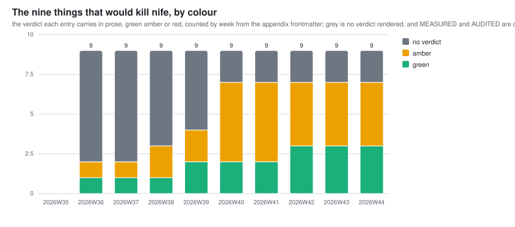

- 2026W41: risk 4 went green on 2026-10-05 UTC (calef); milestones 761 and 766 cut the null syscall's growth to four tasks from 48 to 10 ticks.

## Architecture decisions by status

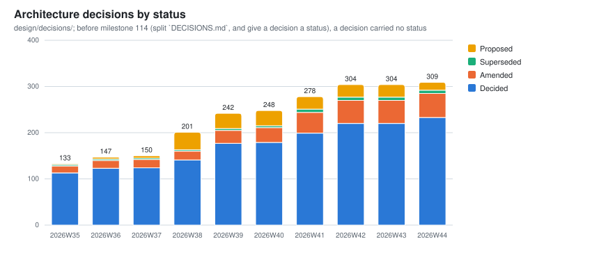

From `design/decisions/`. The gray band in the first three weeks is decisions that predate
a status existing at all, counted as having none rather than as `DECIDED`.

## Names by what the tree records about them

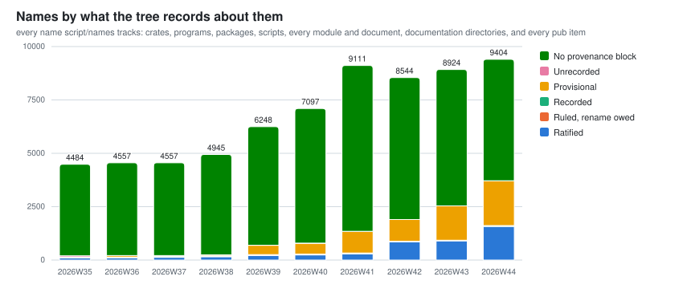

<!-- week-notes: script/metrics writes this -->
- 2026W42: the total fell from 9,111 in 2026W41 to 8,544. Pull requests #2353 (merged 2026-10-18 20:26 UTC) and #2375 (21:58 UTC) narrowed `pub` items no package reads to `pub(crate)`, taking 884 and 411 names out of the no-provenance-block band. The rest of the week added 728. No name was lost; the narrowed items are no longer counted.
<!-- /week-notes -->

What each name's own provenance block says, for every name `script/names` tracks: crates,
programs, packages, scripts, every module (each `.rs` file under a `src/` directory), every
documentation directory and document, and every `pub` item. An item is a function, method,
constant, static, type or trait. A name a rule covers counts as ratified. `Ruled, rename owed` is a provisional
name calef has ruled whose rename has not landed. `No provenance block` is named things with no
readable block. Every kind is counted from the tree, so writing a block moves a name out of that
band without changing the bar's height. The current week's total is checked against
`script/names`. A week is a bar, so a day's rulings show as the current week's bar moving. A rising
`Provisional` band is not debt; the band worth an alarm is `Unrecorded`.

## unsafe blocks outside kernel/src/arch/

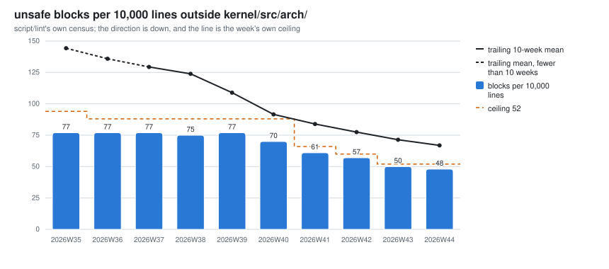

Blocks per 10,000 code lines outside `kernel/src/arch/`, `script/lint`'s gated census; the orange
line is the ceiling its marker held that week, the other the trailing ten-week mean. Only the ratio
is about soundness.

## The same unsafe blocks, by trust boundary

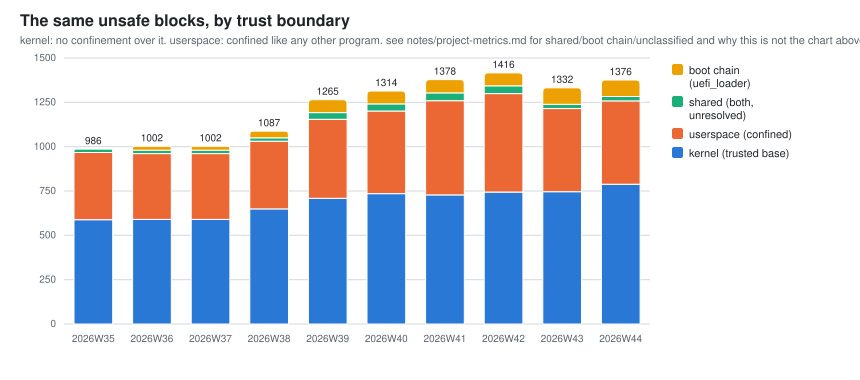

<!-- week-notes: script/metrics writes this -->
- 2026W41: userspace rose 466 to 531. Of those, 29 blocks are c_library and jig, which landed this week; they were in the census and in no band until pull request #2482 (2026-10-20 UTC) placed them.
- 2026W43: every week here was restated on 2026-10-20 UTC by pull request #2482, which generates the crate table from cargo metadata. The unclassified band (60, 39 and 28 in 2026W41 to 2026W43) moved into userspace and shared, and no week's total fell.
<!-- /week-notes -->

The census split by what confines the code: kernel privilege, userspace confinement, both, and
the pre-kernel boot chain. Every week applies today's crate table, generated from `cargo metadata`,
so a crate is counted on its current side throughout.

## Debt paydown

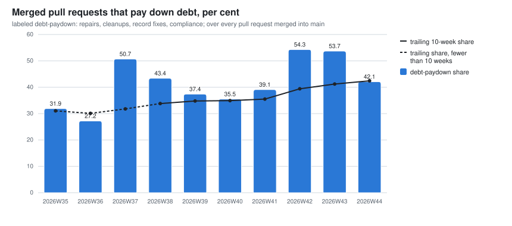

The share of each week's merged pull requests labeled `debt-paydown` ([what
counts](debt-paydown.md)). The label is chosen at the claim and judged from titles, so a lane that
became a repair is missed.

## Milestones built each week

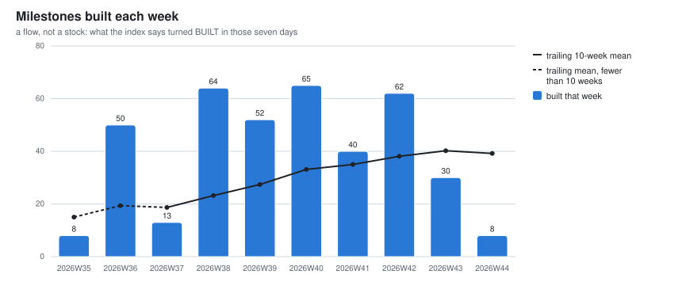

A flow: milestones whose `Built:` date falls in that week, read from today's tree for every week.
It does not reconcile with the `Built` stock (BUGS).
The line is the trailing ten-week mean, drawn rather than stored; it is dashed where fewer than ten
weeks exist behind it.

## Pull requests merged each week

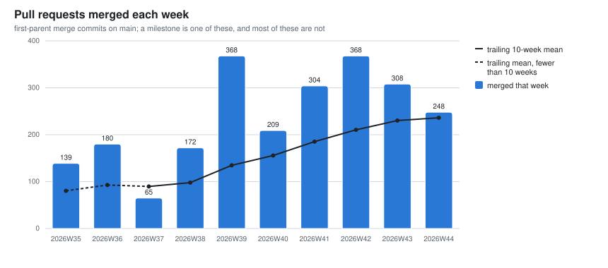

The second flow, counted from `main`'s merge subjects rather than the API, so it backfills to the first commit. 2026W29 and 2026W30 are zeros: the practice starts in
2026W31.
The line is the same trailing mean.

## Merge queue ejections

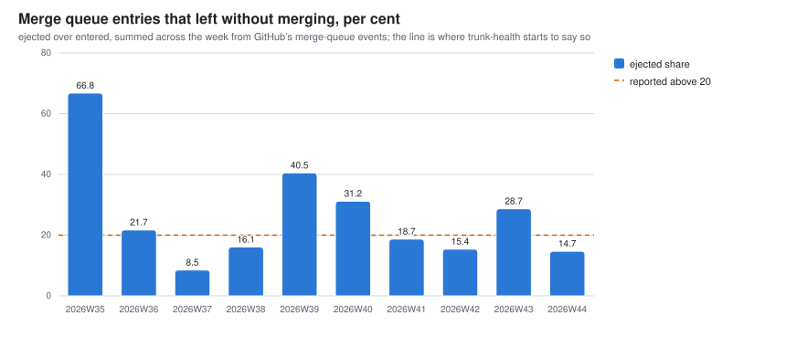

Queue began 2026-08-15; W31 and W32 predate it.

## How long a merge-group build takes

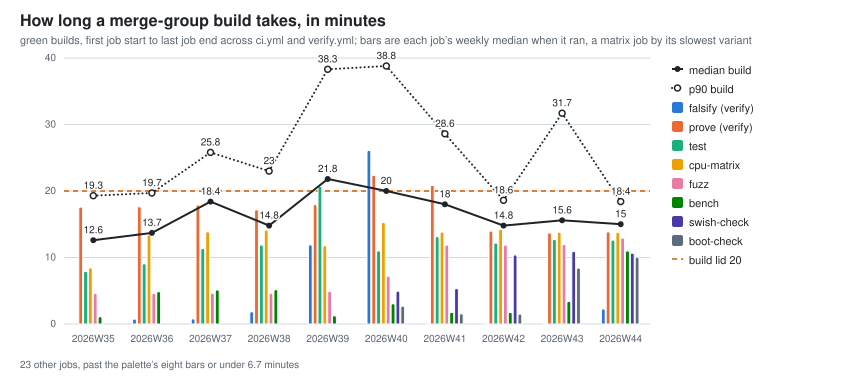

<!-- week-notes: script/metrics writes this -->
- 2026W41: prove shards rebalanced on 2026-10-07 UTC by a 40-run median and split three ways (calef, #1802), planned at 15.7 minutes each from 20.5 and 27
- 2026W41: CI job test ran at 89% of its budget on its newest merge-group run; tracking issue #1930
- 2026W42: re-falsify replays two records at a time (#1979); full-scope shards fell from 16.5 to 8.8 minutes
- 2026W42: CI job cpu-matrix-shard ran at 86% of its budget on its newest merge-group run; tracking issue #2055
- 2026W43: CI job cpu-matrix-shard ran at 90% of its budget on its newest merge-group run; tracking issue #2451
<!-- /week-notes -->

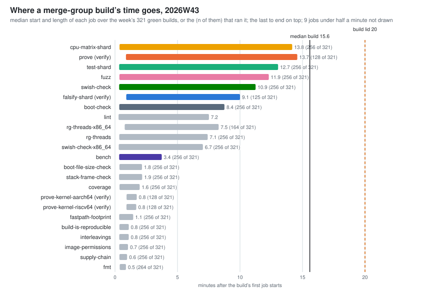

A build is a merge commit's `ci.yml` and `verify.yml` runs (same `head_sha`), first job start to
last job end, green only, from 2026-08-15 (`helpers/ci_job_times.py`). The timeline is the newest full
week.

## Which model wrote it

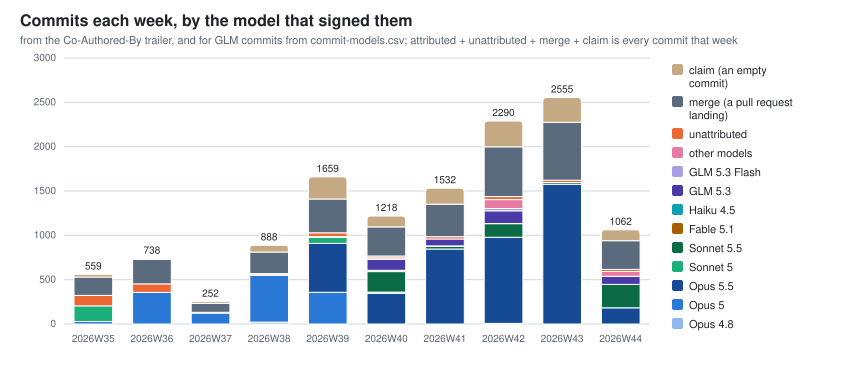

From the `Co-Authored-By` trailer. Attributed plus unattributed plus merge is every commit that
week; a merge is a pull request landing, not writing. 2026W29 predates
the convention, so it is absent rather than zero.

Only Claude Code writes the trailer, so the table counts one vendor. From 2026-09-29 02:33
to 2026-10-01 05:07 UTC the work ran on z.ai's glm-5.3 under opencode, and its 154 commits read
here as unattributed rather than as a model
([the correction](coes/2026-10-03-the-merge-rate.md)). `script/effort` has the same gap and its
charts show that week's z.ai work as nothing at all.

"Other models" is a trailer the script does not recognize.

## Lines touched, by the model that signed them

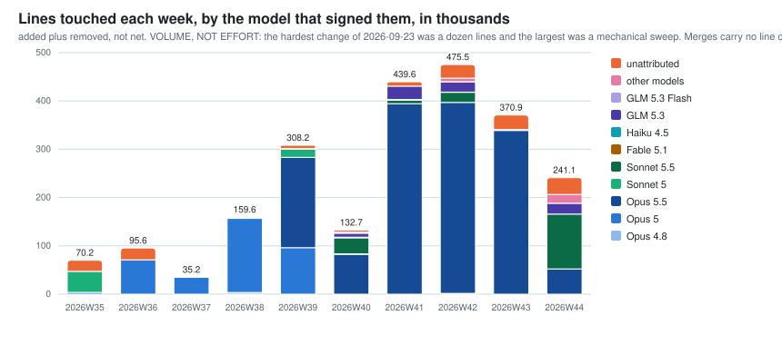

Added plus removed, not net; volume, not effort. Merges count no lines.

## What a turn costs

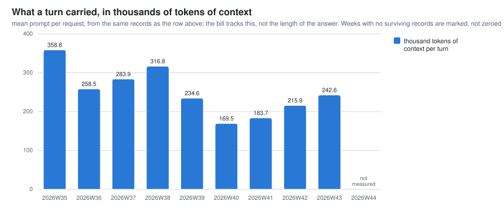

Mean prompt per request, from session records that are not in git. A turn costs the size of its context: cache reads are about 98% of every token spent. 2026W29 through 2026W33 are absent, not zero.

## Milestones by status

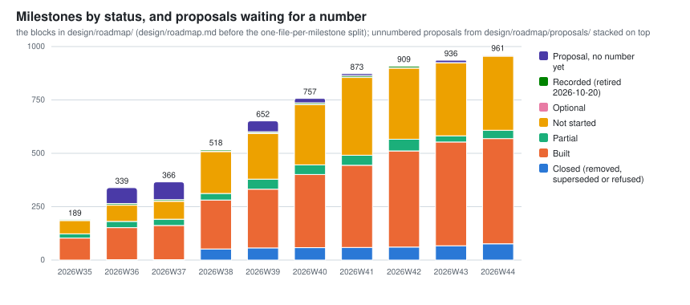

From the milestone blocks in `design/roadmap/`, with unnumbered proposals stacked on top as the
eighth series: work identified and not yet entered into the roadmap, which unlike a provisional name
is closer to debt. `REMOVED`, `SUPERSEDED` and `REFUSED` share one band; `milestones.csv` keeps
them apart. A bar counts numbered milestones, so it is lower than the highest number (some were
never used) and than a listing of `design/roadmap/`, which also holds directories of milestone
parts. The two zero weeks are a restatement artifact; watch `NOT-STARTED`, which grows faster than lanes
drain it.

## Rust in the tree

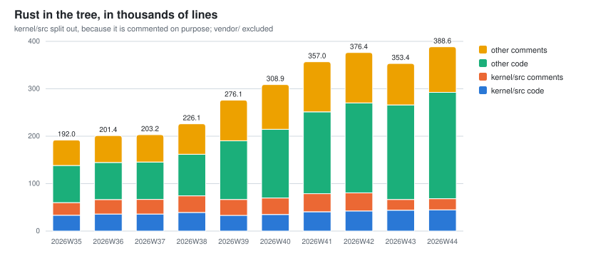

<!-- week-notes: script/metrics writes this -->
- 2026W40: the kernel code series fell 46,665 to 33,192 lines because milestone 609 (the system tests leave the kernel crate), pull request #1404, moved 66 test-only files unchanged into the system_tests crate; no code was deleted
<!-- /week-notes -->

Every tracked `.rs` file outside `vendor/`, with `kernel/src` split from the rest, in thousands of lines (volume, not effort). A line with code and a trailing comment counts as code.

## BUGS sections

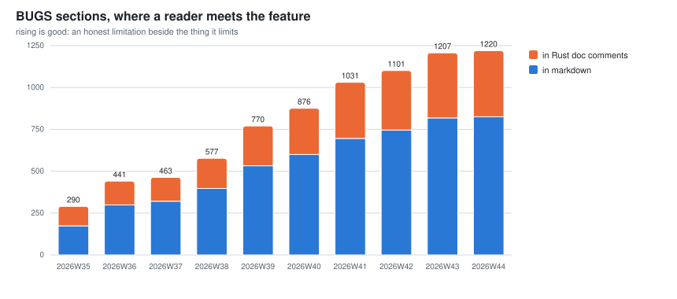

Markdown headings plus Rust doc comments. Rising is good: a `BUGS` section is a limitation written next to the feature it limits.

## Coverage

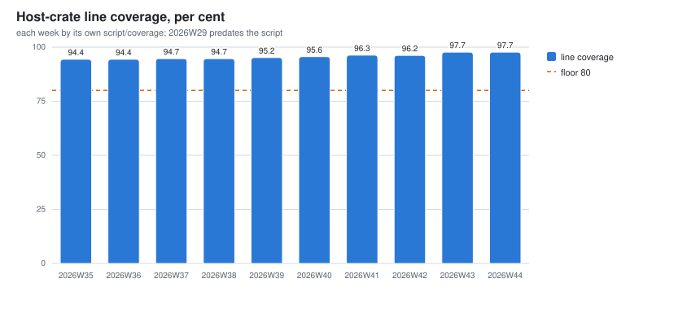

Line coverage, each week measured by its own tree's `script/coverage` on its own pinned nightly, so
this is the one series on the page that is not a restatement. Weeks 2026W30 to 2026W38 were
backfilled that way on 2026-09-19. 2026W29 is empty because no instrument existed yet; the dashed line is the per-file floor `script/coverage` gates on, drawn for scale.

## The lowest-covered file

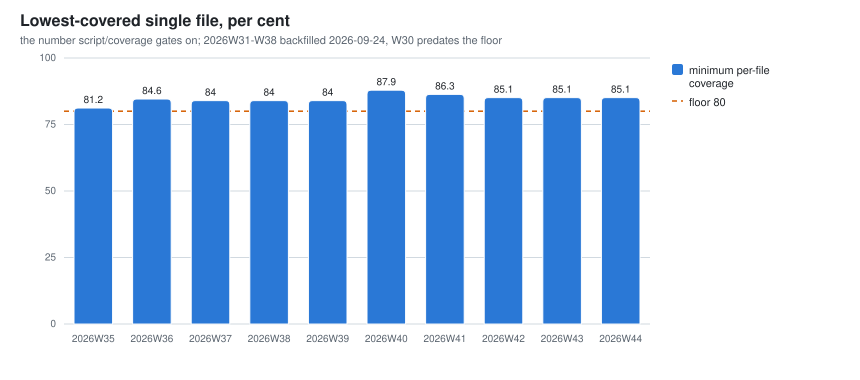

The minimum per-file coverage, which is the number `script/coverage` actually gates on at 80%.
The aggregate can hold steady while one file slides, so this panel predicts a failing build.
2026W31 to 2026W38 were backfilled on 2026-09-24 from each week's own lcov; 2026W30 is empty
because the floor did not exist yet. The provenance is in the register's
[proofs and coverage](register-of-measures/code-proofs-and-coverage.md) appendix.

## Homes

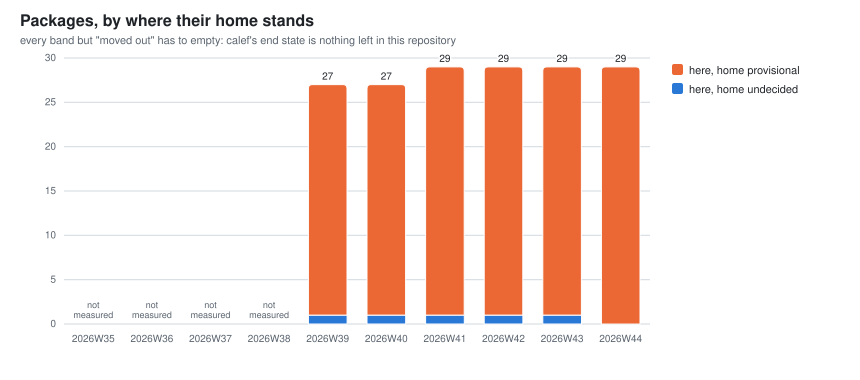

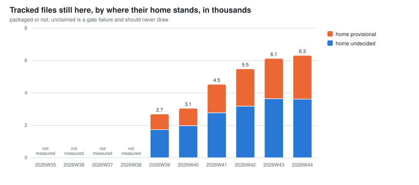

## Benchmark drift since a fixed anchor

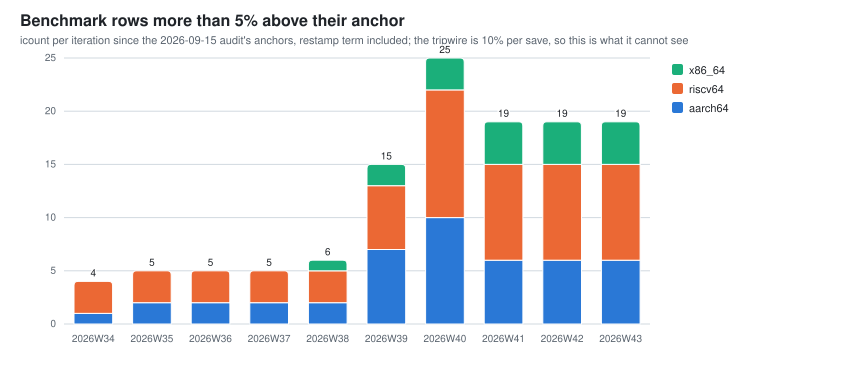

The tripwire compares each save with the last, so steps under 10% add up unseen. This counts rows
past 5% since fixed anchors (calef, 2026-09-26). Every row and reason: [the drift
report](project-metrics/baseline-drift.md).

<!-- baseline-drift: script/metrics writes this -->
2026W43: aarch64 `spawn_reap` +33.14%, riscv64 `spawn_reap` +28.32%, x86_64 `spawn_reap` +10.59%; 19 rows past 5%.
<!-- /baseline-drift -->

- 2026W39: milestone 447 (a thread's vector registers are its own), #1015, 2026-09-21, added 1 to 3% to switch and IPC rows, taking rows past 5% from 2 to 7 (aarch64), 3 to 6 (riscv64), 1 to 2 (x86_64). Nightly bump #1112 added less.

## Interface stability

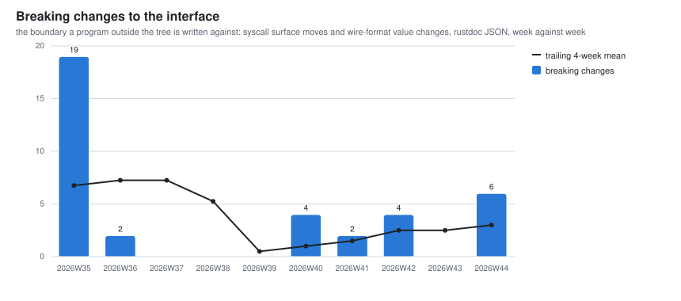

The boundary a program outside the tree is written against, each week: syscall surface moves
and wire-format value changes. [definitions](interface-stability.md),
[per crate](project-metrics/interface-stability.md).

<!-- interface-stability: script/metrics writes this -->
interface, 2026W40 to 2026W43: 10 breaking changes (40 additions); 5 syscall numbers changed, 0 format bumps; 71% co-change.
<!-- /interface-stability -->

## The crates 857 releases

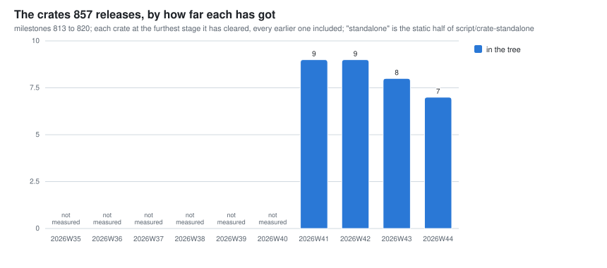

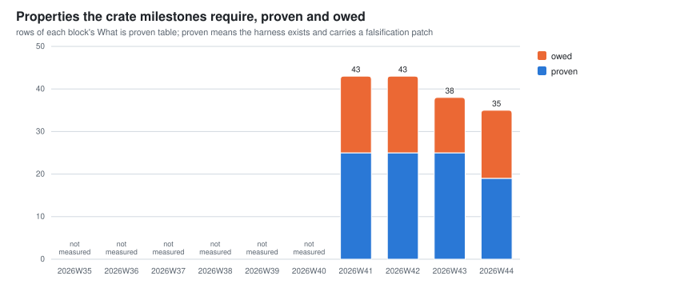

Milestones 813 to 821; all nine crates start in the tree. Both charts read git alone
(`helpers/crate_release.py`).

## Kani proof harnesses, and what can falsify them

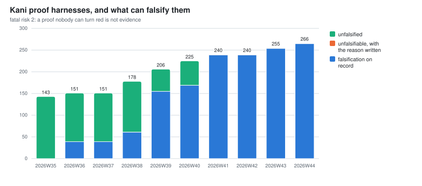

- 2026W41: unfalsified fell 56 to 0 across #1697, #1701 and #1713; the middle band is new (§134 (a harness carries a machine-replayable falsification record, or it is not evidence), amended 2026-10-06 UTC). Its two harnesses were examined and no defect in today's code can turn them red; each carries its reason.

A harness with no falsification record at all counts as unfalsified. The denominator is harnesses, not
code: unharnessed code is outside it ([what each ratio is of](denominators.md#the-published-ratios-and-what-each-is-of)).

## Action items the corrections of error still owe

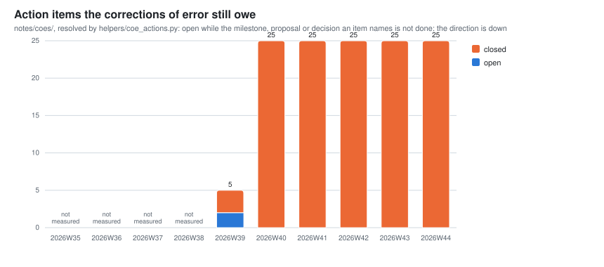

<!-- week-notes: script/metrics writes this -->
- 2026W40: open items fell 3 to 0 on 2026-10-04 UTC. Milestone 641 (a mechanism that reports clean), 725 (count every vendor) and 640 (a gate is not evidence) turned BUILT.
<!-- /week-notes -->

Open while what an item names is not done; the direction is down (`script/roadmap --coe-actions`).
Each week is read from its own commit, so 2026W39 is the first correction, already in this form.

## Writing standards

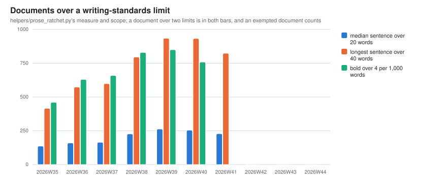

Documents over each writing-standards limit; exempted ones count
([definitions](register-of-measures/ratchet-debt.md)).

## Comment blocks

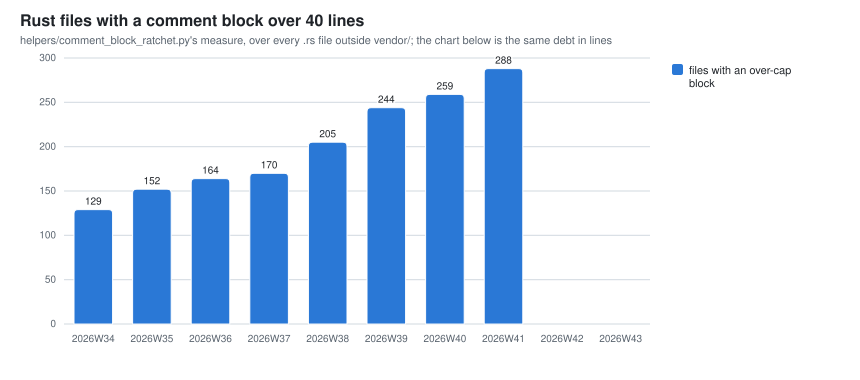

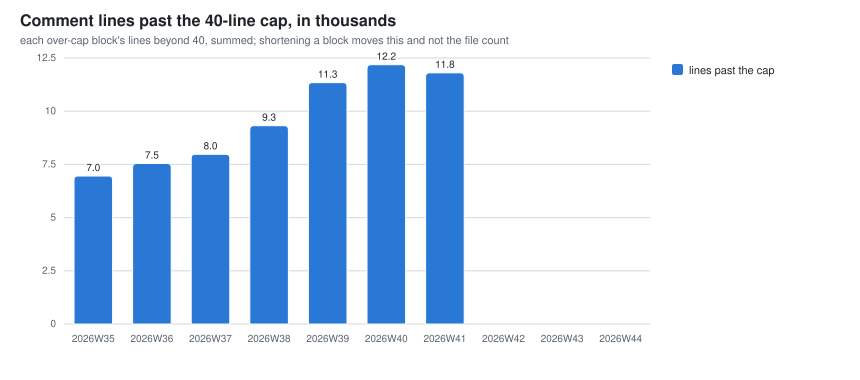

The 40-line comment-block cap: files holding a longer block, then the lines past it.

## Line-number citations

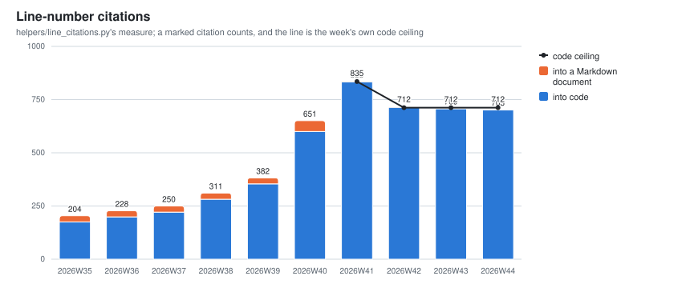

Citations by line number, which §277 (cite a heading or a symbol, never a line number) retires. The
line is the code ceiling. Markdown is held at zero, so what remains there carries an exception marker.

## How it stays current

`.github/workflows/metrics.yml` runs `script/metrics --update` daily and opens or refreshes a pull
request if anything changed. Two columns need a build: coverage, taken on Mondays (UTC), and the
interface series, from `helpers/interface_stability.py`. The cost columns come from session records on one laptop, never a workflow. [How the series stays
current](register-of-measures/reading-the-weekly-series.md#how-the-series-stays-current) has the
rest.

## BUGS

The series' known limitations are in [project-metrics/limitations.md](project-metrics/limitations.md).
